# Vastra

Remember Cher Horowitz's digital wardrobe in *Clueless*? The one where she could see all her clothes, mix and match outfits, and find the perfect look without even opening her wardrobe?

We grew up wishing we had that. So we built it.

Vastra is an AI wardrobe and personal stylist. You photograph the clothes you already own, and Vastra helps you see new ways to wear them: outfits for your day, mix and match on your own photo, and virtual try-on powered by **YouCam**.

Because sometimes you don't need a new wardrobe. You just need to see the one you already have differently.

**Try it here:** [yourvastra.vercel.app](https://yourvastra.vercel.app)

**Demo login** (already has a closet full of clothes, looks and try-ons):
`maya.demo@vastra-demo.dev` / `VastraDemo!2026`

It works best on your phone. On a laptop you'll see the app in a phone frame with a QR code, so scan it and add it to your home screen.

---

## A quick tour

### Today: your outfits for the day
Every morning Vastra styles three looks from your own closet, based on the weather, your plans and your style. Tap *Wear today* and it's logged.

<p>
  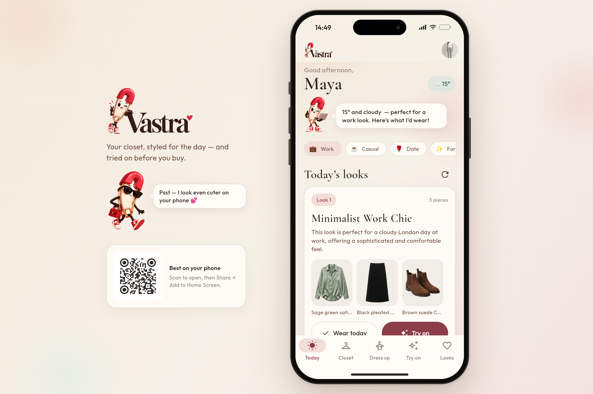
  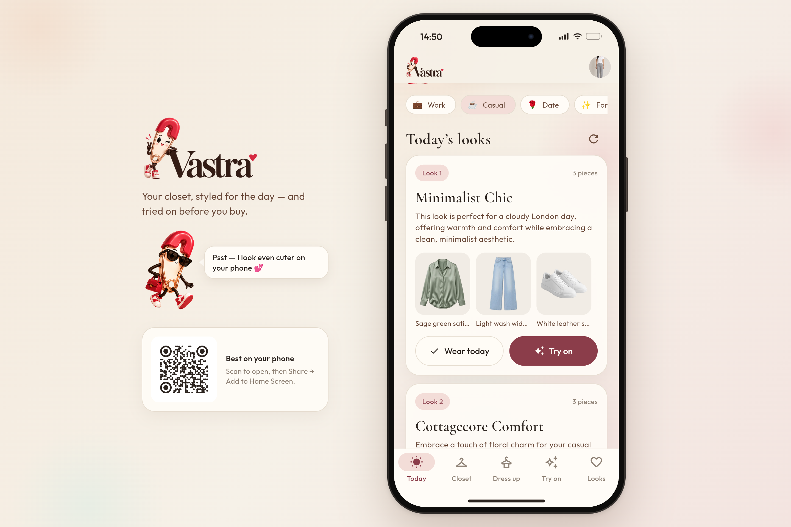
</p>

### Closet: everything you own, in one place
Snap your clothes and Gemini names and tags each piece. YouCam removes the background, so the whole closet looks clean and consistent. There's also a *Rarely worn* filter for the things you keep forgetting about.

<p>
  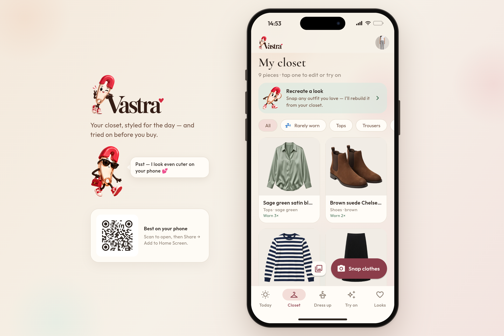
  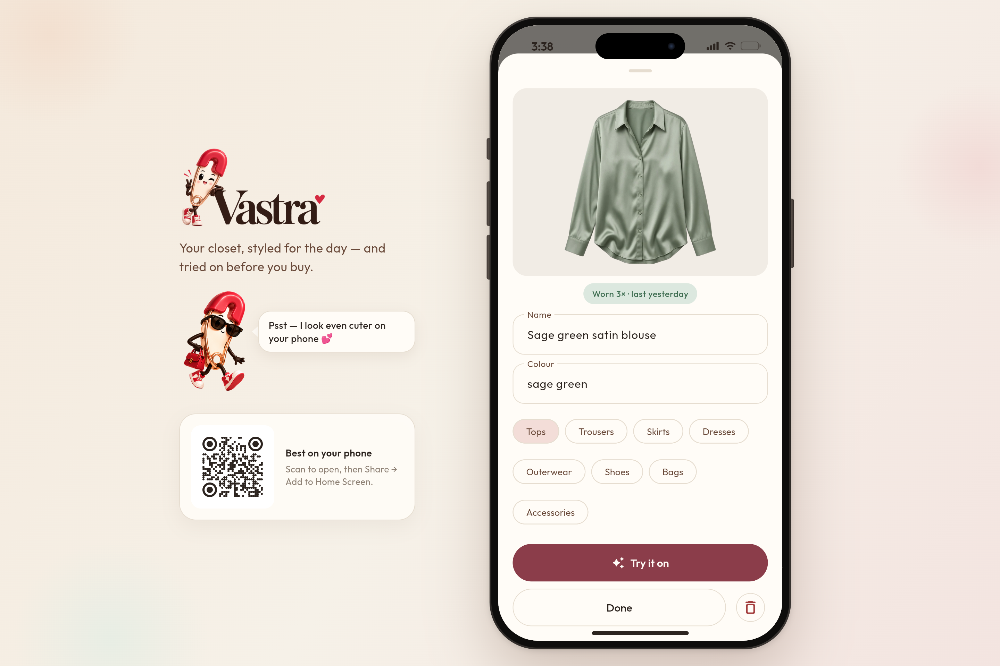
</p>

### Dress up: the Clueless moment
You stand in the middle, and you mix and match tops, bottoms, dresses and layers, or pick a styled look. Hit *Dress up* and YouCam layers the whole outfit onto your photo, piece by piece.

<p>
  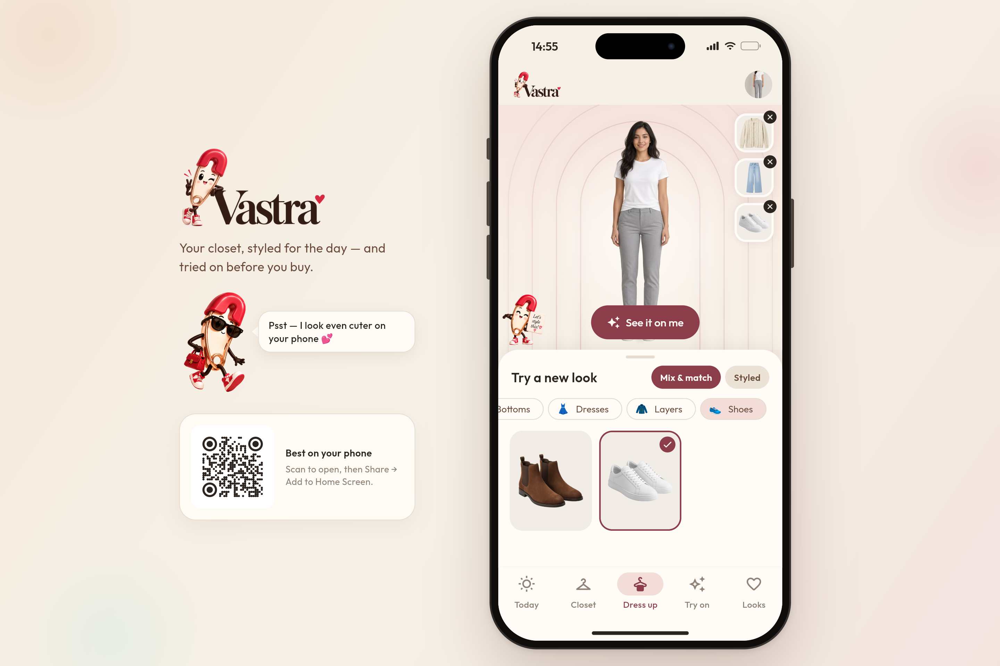
  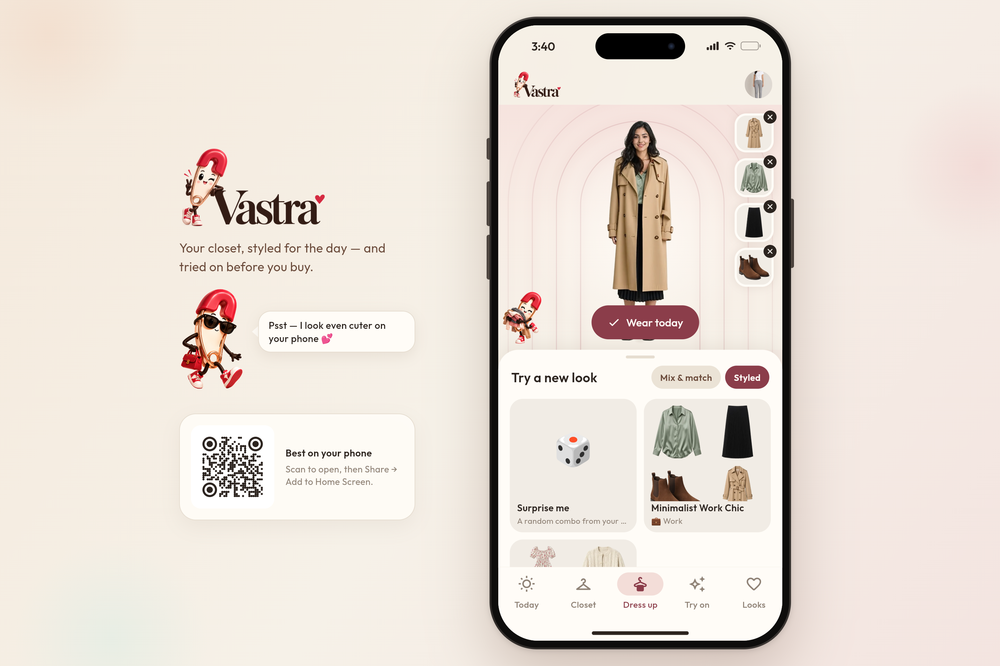
</p>

### Try on: any single piece
Pick a piece from your closet (or any photo) and see it on you. Press and hold to compare with your original photo.

<p>
  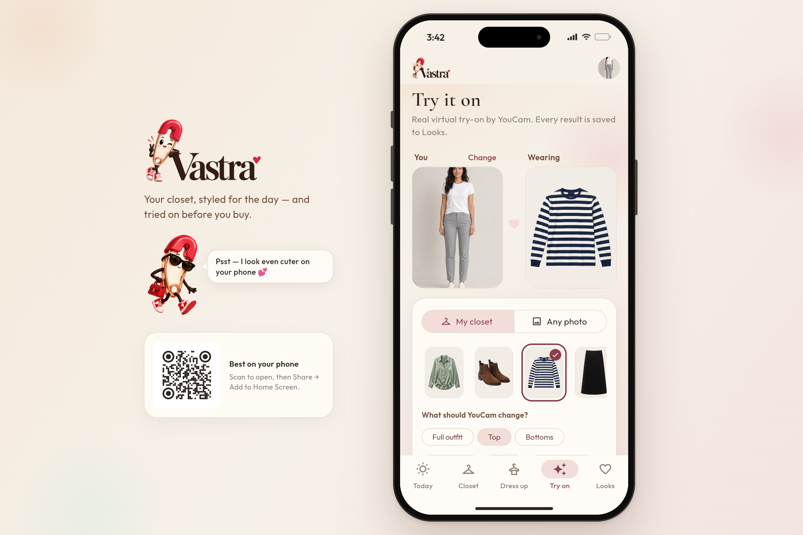
  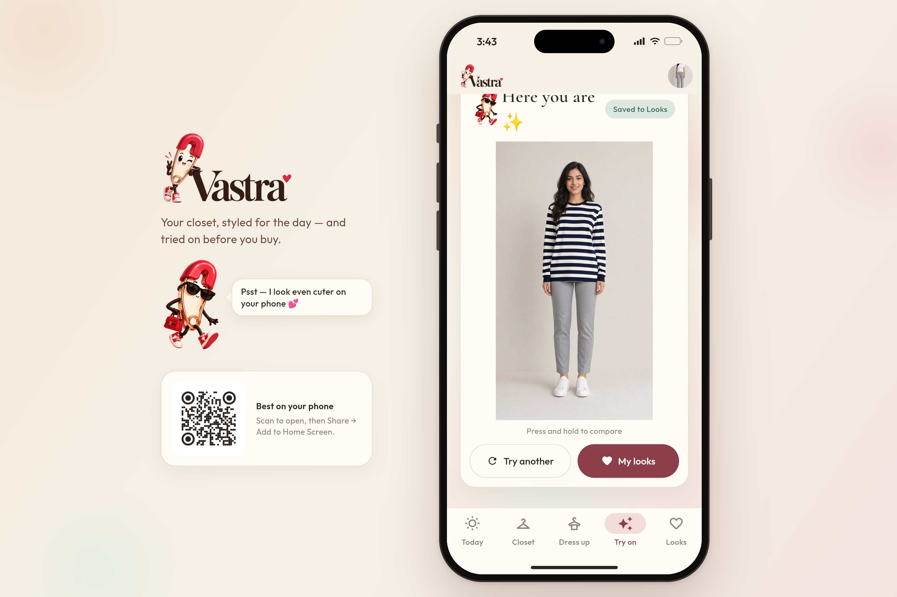
</p>

### Recreate a look: our favourite
Saw an outfit you love on Pinterest, Instagram or on the street? Upload it, and Vastra rebuilds it from the closest pieces you already own. You get a match score, smart swaps and anything that's missing.

<p>
  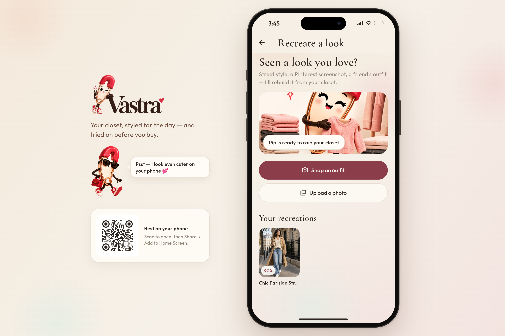
  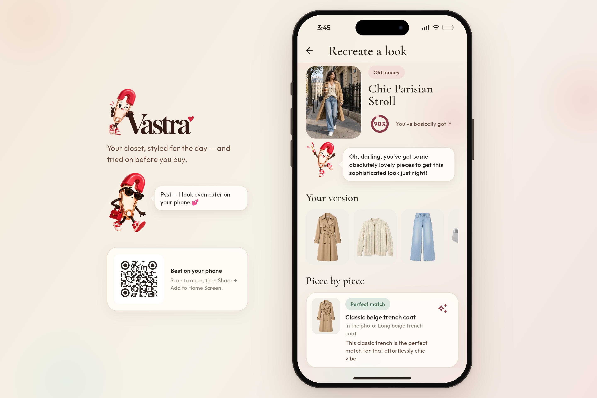
</p>

### Looks: everything you've tried on
Every try-on is saved here. Heart the ones you love and wear them again.

<p>
  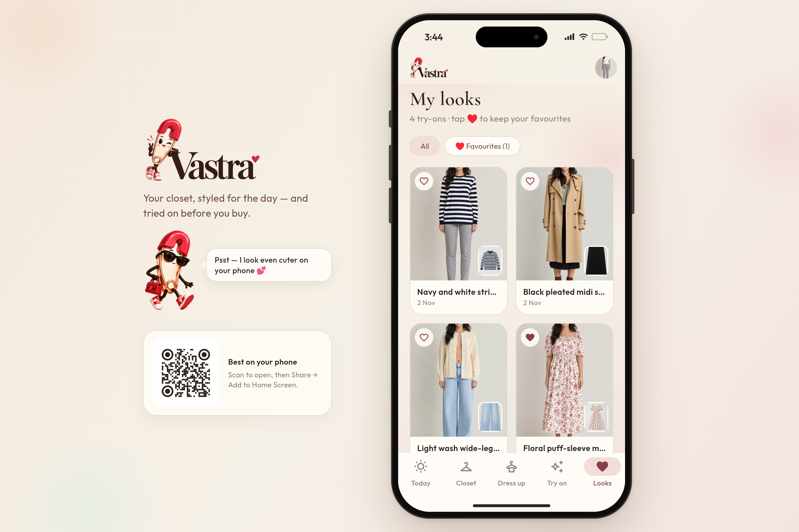
  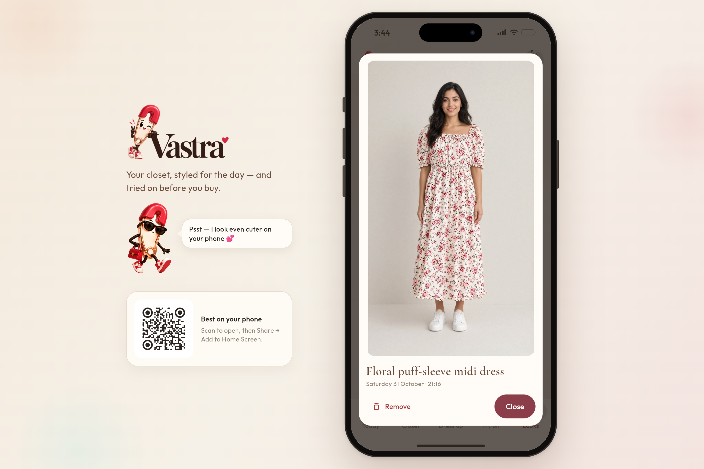
</p>

### On your phone

<p>
  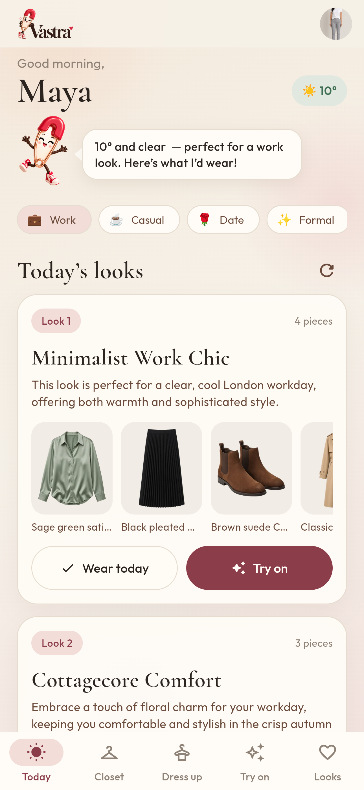
  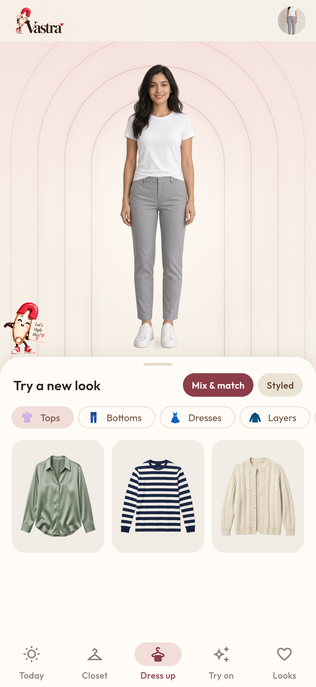
</p>

All 38 screenshots (onboarding, settings, offline mode and more) are in [`devpost-screenshots/`](devpost-screenshots/).

---

## How we built it

- **Flutter** for the app. One codebase for iPhone, Android and the web.
- **Firebase** for sign-in, Firestore, Storage and Cloud Functions.
- **Gemini 2.5 Flash** is the styling brain. It tags your clothes, picks your daily outfits and matches pieces when you recreate a look.
- **YouCam (Perfect Corp)** is the magic you see on screen: `cloth-v4` for virtual try-on and SOD for background removal.
- **sharp** turns every cutout into a small WebP, so the closet loads fast even on a phone.
- **Vercel** hosts the web app.

### What's in the repo

| Folder | What's inside |
|--------|---------------|
| `vastra_app/` | The Flutter app (this is Vastra) |
| `vastra/functions/` | Cloud Functions: try-on, dress up, cutouts, Today looks, recreate |
| `vastra/` | Firebase rules, config and helper scripts |
| `devpost-screenshots/` | Screenshots of every screen |

## Running it yourself

**Backend**

```bash
cd vastra/functions
npm install
npm run build
```

API keys (`YOUCAM_API_KEY`, `GEMINI_API_KEY`, `WEATHERSTACK_API_KEY`) live in Firebase Secret Manager. They're never in the app.

**App**

```bash
cd vastra_app
flutter pub get
flutter run                  # phone or simulator
flutter build web --release  # web version in build/web
```

---

## What's next

- Vastra on the App Store and Play Store
- Smarter daily styling with your calendar and better weather context
- Sharing looks with friends, and a small community closet
- Shopping and marketplace integration, with an affiliate model to keep Vastra going long term

Built with love (and a lot of late nights) for the YouCam hackathon.
